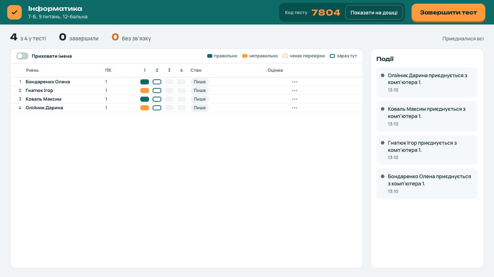

Вчителям: завантажити Клац і прочитати, як ним користуватися, можна на сайті https://andriykohut.github.io/klats/

# Klats

Klats is a free, open-source app for running tests in school computer labs.
The teacher builds tests and runs them from one program on their own
computer, and students take them in any browser on the lab PCs, over the
school's local network, with no accounts, no internet and nothing to
install. Answers survive network drops and restarts, and the teacher
watches the class live and gets graded results.



It has 15 question types: single and multiple choice, true/false, choice
grids, short text, numbers, gaps, ordering, matching, grouping, word banks,
clicking a spot on a picture, labelling a picture, highlighting words and
written answers, which the teacher grades. Questions and answers can hold
pictures, audio, formulas, tables and code. Tests have settings such as time
limits, shuffling, a different set of questions for each student, and
grading scales. The library exports and opens `.klats` files, opens `.mtf`
files in the older format, and everything can be backed up.

## Download

Installers for Windows 10 and 11, macOS 13 or newer, and Linux (Ubuntu
24.04, Linux Mint 22, Debian 13, Fedora 40 or newer) are on the
[website](https://andriykohut.github.io/klats/en/#download) and under
[Releases](https://github.com/andriykohut/klats/releases/latest). They are
not signed yet; [the install guide](https://andriykohut.github.io/klats/en/install/)
shows how to get past the warnings.

## Quick start

You need Go 1.27.3, Node.js 26.12.1 and pnpm 12.14.0. On Linux, the desktop
window also needs GTK 4 and WebKitGTK 6.0 (see
[CONTRIBUTING.md](docs/CONTRIBUTING.md)).

```sh
make gen web build   # the web apps, then the klats binary
make demo            # a sample lesson to try
```

`make demo` prints a student address with the join code, and a teacher
address. Open each in a browser.

## Releasing

Push a version tag, such as `v1.2.3` or `v0.1.0-rc.1`: the Release workflow
builds the installers for Windows, macOS and Linux and drafts a GitHub
release holding them. Fill in its notes, then publish it. To try the
installers without a release, start the workflow by hand on a branch. See
[Packaging](docs/ARCHITECTURE.md#packaging).

The [website](https://andriykohut.github.io/klats/) is published by the
Pages workflow whenever `web/site` changes on `main`. GitHub Pages needs a
paid plan for a private repository, so while the repository is private the
workflow skips its jobs. Once it is public, choose GitHub Actions as the
source under Settings → Pages, and start the workflow by hand. See
[Website](docs/ARCHITECTURE.md#website).

## Learn more

- [docs/ARCHITECTURE.md](docs/ARCHITECTURE.md): how Klats fits together,
  and why.
- [docs/CONTRIBUTING.md](docs/CONTRIBUTING.md): setup, the make targets
  and the conventions.
- [ROADMAP.md](ROADMAP.md): what comes next.
- [docs/manual-test.md](docs/manual-test.md): the checks run on real
  machines before each release.

## Licence

GPL-3.0. See [LICENSE](LICENSE).
